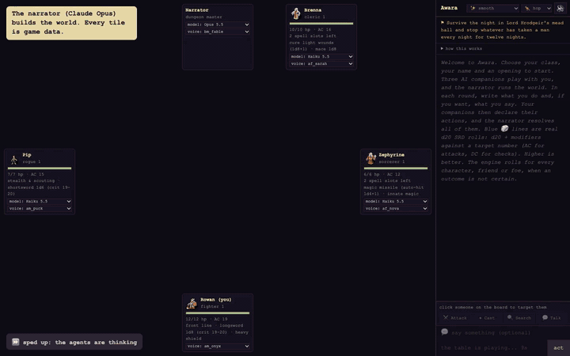

# Awara

A pixel-art tabletop adventure that uses the d20 SRD 3.5 rules.
You play one character.
Claude agents play your three companions, and one more Claude agent is the narrator.

Repository: https://github.com/bettersandeep/awara



New players: watch the full game with sound (79 seconds) here:

https://github.com/user-attachments/assets/cf7b27f2-440a-4625-8bb6-4ffec92930e0

Then read the [play guide](docs/PLAY_GUIDE.md), with screenshots and step-by-step instructions.

## How it works

- **Rules engine** (`src/rules`): real d20 SRD dice, classes, attacks, saves and spells.
  The agents never roll dice or track hit points.
- **World** (`src/scene`): the world is data, not pixels.
  The narrator changes it only with validated scene operations, so a map looks the same every time the party returns to it.
- **Agents** (`src/agents`): the narrator and the companions are Claude Agent SDK sessions.
  They can use only their game tools: no shell, no file access, and no user settings.
  By default Claude Opus 5.5 narrates and Claude Haiku 5.5 plays the companions.
  Each seat can switch between Haiku 5.5, Sonnet 5.5 and Opus 5.5 during play.
- **Personas** (`personas`): one Markdown file per companion, plus the narrator prompt.
- **Browser client** (`public`): a canvas draws the map from the tile catalog.
  The seats around the board show the party, and the side panel shows the story.
- **Speech** (`src/speech`): Kokoro-82M reads the story aloud, locally on the CPU.
  The text is split at punctuation, so commas, full stops and ellipses are real pauses, and long narration is never cut.
  NPC lines are spoken in their own voices, and the narrator can add voice cues such as `(pause)`, `(whisper)` and `*emphasis*`.
  The story log highlights each phrase while it is spoken and shows the cues, the speakers and the pronunciations.

## Requirements

- Node.js 24 or later (it runs TypeScript directly).
- Claude Code, logged in on this machine.
  The agents use that login, so no API key is necessary.
  Opus 5.5 needs `@anthropic-ai/claude-agent-sdk` 0.3.296 or newer, which `npm install` provides.

## Run

```sh
git clone https://github.com/bettersandeep/awara.git
cd awara
npm install
npm start
```

Open http://localhost:8420.
The first start downloads the Kokoro speech model, about 90 MB.

## Develop

```sh
npm run check   # type check and tests
```

To add a companion, write `personas/<id>.md` and add one entry to `COMPANION_POOL` in `src/party.ts`.
To add an opening, add one entry to `SCENARIOS` in `src/scenarios.ts`.

## Credits

- Tiles and sprites: [Dungeon Crawl Stone Soup tiles](https://opengameart.org/content/dungeon-crawl-32x32-tiles), CC0.
  `scripts/curate-tiles.ts` copies the chosen tiles and writes `public/catalog.json`.
- Rules: the [d20 System Reference Document](https://www.d20srd.org/), Open Game License.
- Speech: [Kokoro-82M](https://huggingface.co/hexgrad/Kokoro-82M), Apache 2.0.
