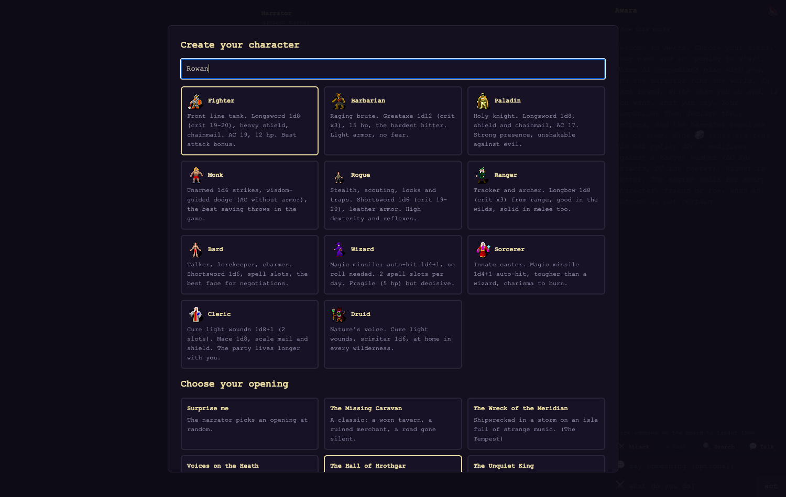
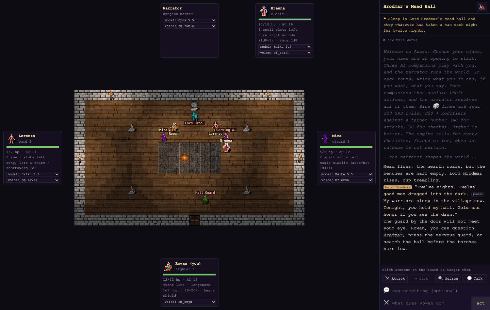
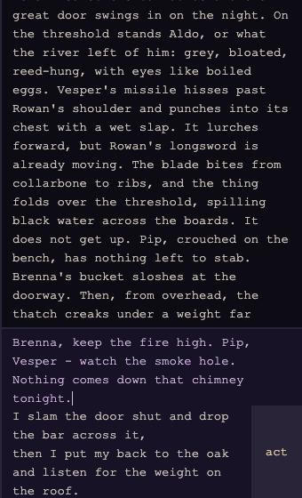
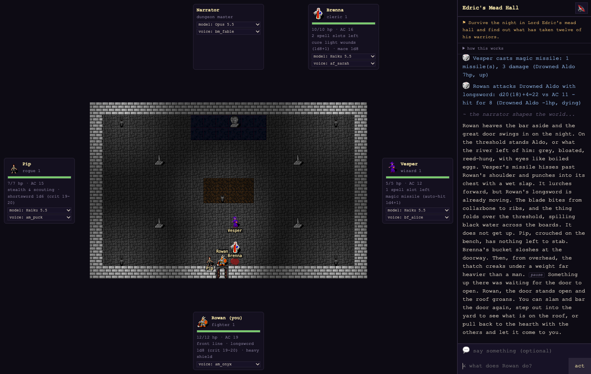
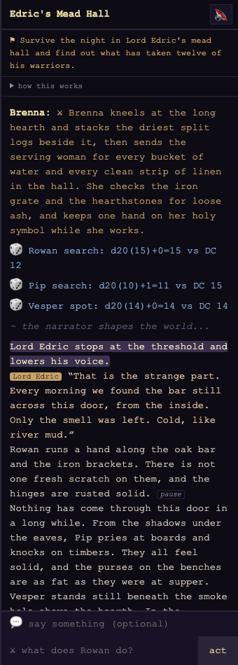
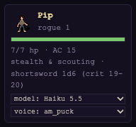

# Awara play guide

Awara is a pixel-art tabletop adventure with the d20 SRD 3.5 rules.
You play one hero.
Three Claude agents play your companions, and one more Claude agent is the narrator who runs the world.
The narrator draws every place on the board and reads the story aloud.

## Watch a game

https://github.com/user-attachments/assets/cf7b27f2-440a-4625-8bb6-4ffec92930e0

A 79-second game with sound: character creation, the opening scene, the spoken story with its highlight, one round, and a fight.
The waits for the AI turns are sped up in the video.

## Start the game

Watch the setup, with sound (67 seconds):

https://github.com/user-attachments/assets/00887afb-d882-412f-b845-4d0a941ddd16

1. Install Node.js 24 or later.
2. Log in to Claude Code on this computer: run `claude auth login`.
   The agents use that login, so you do not need an API key.
3. Get the game and start it:

   ```sh
   git clone https://github.com/bettersandeep/awara.git
   cd awara
   npm install
   npm start
   ```

4. Open http://localhost:8420 in Chrome.

The first start downloads the speech model (about 90 MB).
After that, the game starts in a few seconds.

## Create your character



1. Type a name for your hero.
2. Select a class.
   Each card tells you what the class is good at.
3. Select an opening, or select **Surprise me**.
4. Click **Enter the world**.

The classes have four roles.
Your three companions fill the roles that you did not take, so the party always has a front line, a skirmisher, a spellcaster and a healer.
The companions change for each adventure.

| Role | Classes | Good at |
| --- | --- | --- |
| Martial | Fighter, Barbarian, Paladin, Monk | Holding the front line and hitting hard |
| Skirmish | Rogue, Ranger, Bard | Scouting, archery, locks, traps and talking |
| Arcane | Wizard, Sorcerer | Magic missile, which always hits |
| Divine | Cleric, Druid | Healing with cure light wounds |

The openings borrow from great stories: The Tempest, Macbeth, Beowulf, Hamlet, A Midsummer Night's Dream, The Canterbury Tales, Faust, The Odyssey and Dracula.
The narrator writes the rest of the plot while you play.

## The table



- **The board** in the center shows the current place.
  Every person and creature that the story mentions is on the board, with a name tag.
  Gold tags are your party, and red tags are everyone else.
  A wounded character has an HP bar under its feet: green, then yellow, then red.
  Torches and fires light the area around them; your party carries a little light too.
  Click a character to make it your target; gold brackets mark it.
- **The seats** around the board show the table.
  The narrator sits at the top, your companions sit at the sides, and you sit at the bottom.
  A seat glows while that voice speaks.
- **The side panel** on the right shows the place name, your quest (the ⚑ line) and the story.
- **How this works** opens a short summary of the rules.

## Play a round



Each round has three steps:

1. **You declare.**
   Write what your hero says in the 💬 field (you can leave it empty).
   Write what your hero does in the ⚔️ field.
   Press Enter or click **act**.
   To start a new line in a field, press Shift+Enter.
2. **Your companions declare.**
   Each companion decides what to say and do.
   Their lines appear in the story with their names.
3. **The narrator resolves.**
   The narrator rolls the dice, moves everyone on the board, and tells you what happens.
   The narration ends with what you can do next.

While a round runs, the input fields lock and show a timer.
Each companion's line appears as soon as that companion decides.
A round usually takes about a minute, and the first scene about 30 seconds.

**Quick actions** save typing.
Click a character on the board to target it, then click a button:

| Button | It writes |
| --- | --- |
| ⚔️ Attack | "I attack (target)." or "I attack the nearest enemy." |
| ✦ Cast | Magic missile for wizards and sorcerers; cure light wounds for bards, clerics and druids. Greyed out with no spell slots left. |
| 🔍 Search | "I search the area carefully." |
| 💬 Talk | "I talk to (target).", and the cursor moves to the 💬 field. |

A button only writes the action; you can change it before you send it.

Good actions are concrete:

- "I ask the innkeeper who saw the caravan last."
- "I climb onto the cart and shoot at the nearest goblin."
- "I search the altar for hidden writing."

You can do anything that your hero could try.
You can also talk to your companions; they hear you.

## Dice and rules



The game uses the d20 SRD 3.5 rules.
The rules engine rolls every die; the AI agents never decide a result without a roll.
Every roll appears in the story as a blue 🎲 line, for example `Rowan attacks Drowned Aldo with longsword: d20(18)+4=22 vs AC 11 - hit for 8`.

- **Attack:** d20 + attack bonus against the target's armor class (AC).
  A natural 20 always hits, and a natural 1 always misses.
  A roll in the weapon's threat range can be a critical hit, which multiplies the damage.
- **Skill check:** d20 + skill ranks + ability bonus against a difficulty class (DC).
  Each class starts trained in its class skills, for example a rogue in open lock and disable device.
- **Saving throw:** d20 + Fortitude, Reflex or Will bonus against a DC.
- **Initiative:** at the start of a fight, everyone rolls to set the turn order.
- **Spells:** casters have spell slots for the day, and each class casts only its own spells.
  Magic missile always hits; cure light wounds heals.
  A full night's rest in a safe place brings the slots back and heals 1 hp per level.
- **Hit points:** at 0 hp a character is disabled, below 0 dying, and at -10 dead.
  A dying character cannot attack or cast.

Hit points, AC and spell slots are on each seat card.

## Listen to the story



- Click 🔇 at the top of the side panel to turn on the voice.
  It changes to 🔊, and new lines then play by themselves.
- Click ▶ after any line to hear it again.
- While a line plays, the phrase that is spoken is highlighted.
- Each person who speaks in the narration has a gold label and their own voice.
- Grey tags are voice cues, for example *pause*, *whisper* or *slowly*.
  The voice obeys them.
- Words in *italics* are spoken with emphasis.
- A name with a dotted underline shows its pronunciation when you hover over it.

The voice runs on your computer, so the speech can arrive a few seconds after the text.

## Board look

The list next to the speaker button in the side panel picks how the board looks.
The game continues when you change it, and the browser remembers your choice.

- **✨ smooth** (default): characters walk tile by tile around walls, breathe while they wait, lunge and flinch in combat, and act out what the narrator describes as the voice speaks it.
  Spells fly as glowing missiles, healing sparkles, and the light flickers softly.
- **░ dithered light**: the same board, with light and darkness drawn as fine dot patterns.
- **▓ duotone**: the whole board in two inks, cream on near-black, with dots that shimmer in bright light.
- **▒ palette**: the whole board in a 16-colour retro palette.
- **▦ canvas**: the first, simpler board, with stepped pixel light and no combat motion.
  Switching to or from it reloads the page.

The three dot looks use ordered (Bayer) dithering at one dot per screen pixel.
You can also open a look directly, for example http://localhost:8420/?look=duotone.

## Seats, models and voices



Each seat has two menus:

- **model:** which Claude model plays this seat.
  The narrator uses Opus 5.5, and the companions use Haiku 5.5.
  You can change any seat to Haiku 5.5, Sonnet 5.5 or Opus 5.5 at any time.
  Faster models make faster rounds; stronger models write richer stories.
- **voice:** which voice reads this character's lines.

A change applies from the next turn.

## Tips

- Read the last lines of the narration: they list the choices that the narrator expects.
- Use your class: a rogue scouts and opens locks, a cleric heals, a bard talks.
- Ask people questions.
  The world has more to tell than the first scene shows.
- Keep each action to one or two sentences.
  Long plans take longer to resolve.

## Problems

| What you see | What to do |
| --- | --- |
| "reconnecting..." at the top | The page reconnects by itself when the server is back. The story comes back too. |
| The board stays empty after the first scene | Wait for the round to end. The narrator gets one more turn to draw the scene. |
| No sound | Click 🔇 once. Browsers block sound until you click on the page. |
| "The narrator timed out" | Send your action again. |
| A new game after a server restart | The game is not saved yet. A restart starts a new adventure. |
